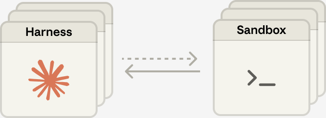

# 🚀 Managed Agent X · Node.js SDK

<a href="README.md" target="_blank" rel="noopener noreferrer">简体中文</a> · **English**　|　<a href="https://github.com/zero-harness/managed-agent-x" target="_blank" rel="noopener noreferrer">Java</a> · <a href="https://github.com/zero-harness/managed-agent-python" target="_blank" rel="noopener noreferrer">Python</a> · <a href="https://github.com/zero-harness/managed-agent-x-nodejs" target="_blank" rel="noopener noreferrer">Node.js</a>

> 🔥 **It’s 2027. You’re tuning the ReAct loop in your agent harness. The team next door just got its first PR from a cloud agent.**
>
> The loop takes a few lines. The hard part comes at 2 a.m. Your agent just filed a ticket and the connection dropped. Would you hit retry?

## How much code should it take to switch agents?

**Our goal is one config change to send the same task to Kimi instead of Claude.** We’re designing a common SDK for Java, Python, and Node.js to submit work and collect results. If your task needs stream recovery or human approval, the SDK will tell you which providers support it.

## Why use a managed agent?

The platform runs the reasoning loop, coordinates tools, and maintains session state. Developers can submit tasks and retrieve results through an API, freeing them to focus on their application.

## Who already runs the agent loop for you?

| Provider | Adapter target · SDK in design |
| --- | --- |
| Anthropic | <a href="https://platform.claude.com/docs/en/managed-agents/sessions" target="_blank" rel="noopener noreferrer">Claude Managed Agents</a> |
| Z.ai | <a href="https://docs.bigmodel.cn/cn/managed-agents/quickstart" target="_blank" rel="noopener noreferrer">Z Managed Agents</a> |
| Kimi | <a href="https://platform.kimi.com/docs/hosted-agents/overview" target="_blank" rel="noopener noreferrer">Kimi Hosted Agents</a> |
| Alibaba Cloud | <a href="https://help.aliyun.com/zh/model-studio/session-api/" target="_blank" rel="noopener noreferrer">Model Studio Managed Agents</a> |
| Volcengine | <a href="https://docs.volcengine.com/docs/ark/start-session?lang=zh" target="_blank" rel="noopener noreferrer">Ark Managed Agents</a> |
| Meituan | <a href="https://catpaw.meituan.com/docs#/agent/api-reference" target="_blank" rel="noopener noreferrer">CatPaw Managed Agents</a> |
| Qoder | <a href="https://docs.qoder.com/cloud-agents/overview" target="_blank" rel="noopener noreferrer">Qoder Cloud Agents</a> |
| OpenAI | <a href="https://developers.openai.com/api/docs/guides/agents-api/architecture" target="_blank" rel="noopener noreferrer">Agents API (managed Codex harness)</a> |
| Google | <a href="https://ai.google.dev/gemini-api/docs/custom-agents" target="_blank" rel="noopener noreferrer">Gemini Managed Agents (configurable Antigravity)</a> |
| Microsoft | <a href="https://learn.microsoft.com/azure/foundry/agents/concepts/prompt-agents" target="_blank" rel="noopener noreferrer">Foundry Prompt Agents</a> |
| AWS | <a href="https://docs.aws.amazon.com/bedrock-agentcore/latest/devguide/harness-vs-runtime.html" target="_blank" rel="noopener noreferrer">Amazon Bedrock AgentCore harness</a> |

## How Claude separates the brain from the hands

On the left, Claude and the harness decide what to do next. On the right, sandboxes execute tool calls on demand. One harness can use several sandboxes.

<a href="https://www.anthropic.com/engineering/managed-agents#many-brains-many-hands" target="_blank" rel="noopener noreferrer">Engineering article</a>
