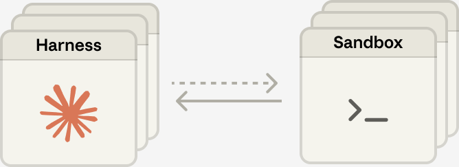

# 🚀 Managed Agent X · Node.js SDK

**简体中文** · <a href="README.en.md" target="_blank" rel="noopener noreferrer">English</a>　|　<a href="https://github.com/zero-harness/managed-agent-x" target="_blank" rel="noopener noreferrer">Java</a> · <a href="https://github.com/zero-harness/managed-agent-python" target="_blank" rel="noopener noreferrer">Python</a> · <a href="https://github.com/zero-harness/managed-agent-x-nodejs" target="_blank" rel="noopener noreferrer">Node.js</a>

> 🔥 **2027 年，如果你还在自己写 Agent Harness、自己维护 ReAct Loop，你已经输在了起跑线上。**

## 用一套 SDK 统一管理多厂商托管 Agent

让 Java、Python 和 Node.js 开发者用同一套操作管理各家的 **Managed Agents**：选择 Agent、提交输入、读取输出。会话续接、事件回放和审批按厂商能力提供。

## 托管 Agent 名录

只收录**由厂商托管 Agent 执行循环，且开放 API** 的产品。推理、工具调用和后续步骤都由云端驱动，应用可以直接派发任务。

| 厂商 | 适配目标 · SDK 设计中 |
| --- | --- |
| Anthropic | <a href="https://platform.claude.com/docs/en/managed-agents/sessions" target="_blank" rel="noopener noreferrer">Claude Managed Agents</a> |
| 智谱 | <a href="https://docs.bigmodel.cn/cn/managed-agents/quickstart" target="_blank" rel="noopener noreferrer">Z Managed Agents</a> |
| Kimi | <a href="https://platform.kimi.com/docs/hosted-agents/overview" target="_blank" rel="noopener noreferrer">Kimi Hosted Agents</a> |
| 阿里云 | <a href="https://help.aliyun.com/zh/model-studio/session-api/" target="_blank" rel="noopener noreferrer">百炼 Managed Agents</a> |
| 火山引擎 | <a href="https://docs.volcengine.com/docs/ark/start-session?lang=zh" target="_blank" rel="noopener noreferrer">方舟 Managed Agents</a> |
| 美团 | <a href="https://catpaw.meituan.com/docs#/agent/api-reference" target="_blank" rel="noopener noreferrer">CatPaw Managed Agents</a> |
| Qoder | <a href="https://docs.qoder.com/cloud-agents/overview" target="_blank" rel="noopener noreferrer">Qoder Cloud Agents</a> |
| OpenAI | <a href="https://developers.openai.com/api/docs/guides/agents-api/architecture" target="_blank" rel="noopener noreferrer">Agents API（托管 Codex）</a> |
| Google | <a href="https://ai.google.dev/gemini-api/docs/custom-agents" target="_blank" rel="noopener noreferrer">Gemini Managed Agents（可配置的 Antigravity）</a> |
| Microsoft | <a href="https://learn.microsoft.com/azure/foundry/agents/concepts/prompt-agents" target="_blank" rel="noopener noreferrer">Foundry Prompt Agents</a> |
| AWS | <a href="https://docs.aws.amazon.com/bedrock-agentcore/latest/devguide/harness-vs-runtime.html" target="_blank" rel="noopener noreferrer">Amazon Bedrock AgentCore harness</a> |

## Claude 的「脑手分离」架构

Harness 决定下一步，工具和沙箱负责执行，Session 保存历史。

<a href="https://www.anthropic.com/engineering/managed-agents#decouple-the-brain-from-the-hands" target="_blank" rel="noopener noreferrer">工程原文</a>
